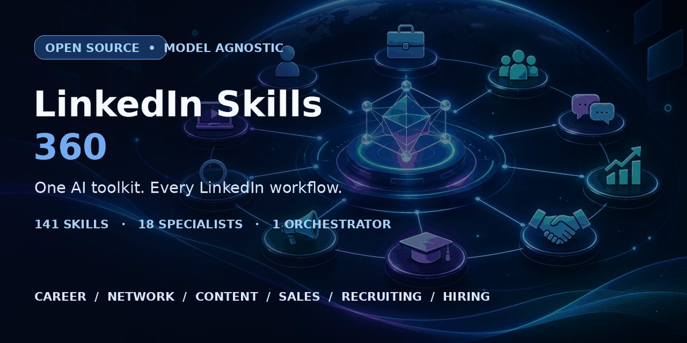
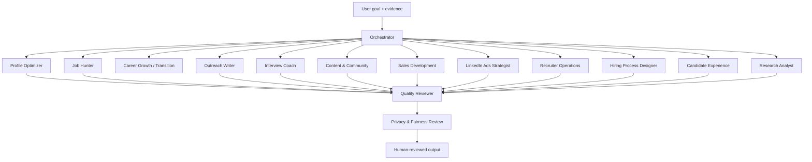

<div align="center">

# LinkedIn Skills 360

### One AI toolkit. Every LinkedIn workflow.

<p><em>Open, model-agnostic skill ecosystem for careers, creators, sales, recruiting and hiring.</em></p>

[](LICENSE)
[](https://agentskills.io/)
[](adapters/README.md)
[](docs/privacy-and-safety.md)
[](https://voyager67.github.io/LinkedIn-Skills-360/)

**141 focused skills · 18 specialist agents · 1 orchestrator · 18 example prompts · 32 reusable templates**

**[Explore the live site](https://voyager67.github.io/LinkedIn-Skills-360/) · [Browse skills](skills/README.md) · [Meet the agents](agents/orchestrator.md) · [Get started](INSTALL.md)**

</div>



> **Profile. Discover. Apply. Connect. Create. Sell. Recruit. Hire. Grow.**

LinkedIn is more than a profile and a feed. It is a professional identity, a job-search surface, a relationship network, a publishing channel, a company presence, a sales workspace and a recruiting pipeline. The work around it is scattered across dozens of repetitive tasks.

**LinkedIn Skills 360 turns those tasks into a reusable, model-agnostic skill ecosystem.** Bring your AI model, choose the workflow, provide real context and evidence, and get a structured plan, credible draft, review checklist or decision-support artifact.


*Original illustrative GIF artwork. This is not a product screenshot or an official LinkedIn asset.*

## The ecosystem at a glance

| | Included |
|---|---:|
| Focused `SKILL.md` workflows | **141** |
| Specialist agent prompts | **18** |
| Orchestrator | **1** |
| Reusable templates | **32** |
| Example prompts | **18** |
| Runtime dependency | **None** |
| Required model provider | **None** |

Counts are derived from repository contents. They describe the library, not adoption, benchmark performance or employment outcomes.

## What can you do with it?

| Domain | Workflows |
|---|---|
| **Profile & reputation** | Headline, About, experience, SEO keywords, recommendations, portfolio and privacy reviews |
| **Jobs & career operations** | Job discovery, Boolean search, alerts, role-fit analysis, applications, internships, offers and career growth |
| **Networking & outreach** | Referrals, alumni, informational interviews, recruiter messages, mentoring and follow-ups |
| **Interviews & offers** | Company research, interview briefs, STAR stories, compensation research and negotiation |
| **Content & community** | Posts, comments, newsletters, articles, carousels, events, groups and executive voice |
| **Company presence** | Company Pages, employer brand, Page analytics and employee advocacy |
| **Paid campaigns** | Campaign Manager, audience review, Lead Gen Forms, creative briefs and measurement |
| **Sales & partnerships** | Sales Navigator, account intelligence, social selling, prospecting and discovery |
| **Recruiting & hiring** | Role intake, sourcing, talent maps, candidate experience, structured interviews and onboarding |
| **Learning & development** | LinkedIn Learning pathways, competency mapping and L&D program design |

**Every skill** has activation triggers, required inputs, a step-by-step workflow, output format, example prompt, edge cases and quality/safety checks. Browse the [complete skill index](skills/README.md) or the interactive [website catalogue](https://voyager67.github.io/LinkedIn-Skills-360/skills/).

## Meet the multi-agent team

The orchestrator selects the smallest useful workflow, hands bounded context to specialists and routes public-facing or sensitive work through quality and privacy review.



The 18 specialist role prompts cover profile optimization, job search, outreach, interviews, recruiting, content, career transition, research, quality, privacy/fairness, sales, company pages, ads, creator/community, candidate experience, recruiter operations and hiring-process design. See the [agent directory](agents/) and [handoff protocol](docs/agent-protocol.md).

**Architecture honesty:** these are portable Markdown role specifications, not a bundled multi-agent runtime. Hosts with delegation can run specialists separately; a single-model host can follow the same handoffs sequentially. Persistent memory, tools, parallel execution and automatic discovery depend on the host.

## Built for every professional path

- **Students & freshers:** turn coursework and projects into truthful evidence, find internships, build portfolios and connect with alumni.
- **Job seekers:** search strategically, compare requirements, tailor application materials, track progress and prepare for interviews.
- **Working professionals:** strengthen professional presence, grow relationships, plan promotions and navigate internal mobility.
- **Career switchers & returners:** map transferable skills, tell career-break stories and build proof for a new direction.
- **Creators & founders:** plan content, newsletters, events, communities and a credible company presence.
- **Freelancers & sales teams:** research accounts, explain services, qualify leads and create useful partnerships.
- **Recruiters & talent teams:** structure role intake, sourcing, candidate communications, interviewing and funnel reviews.
- **Hiring managers:** define job-related competencies, consistent interview plans, work samples and evidence-based debriefs.

Explore the [website use-case pages](https://voyager67.github.io/LinkedIn-Skills-360/use-cases/).

## 60-second quick start

### 1. Clone the repository

```bash
git clone https://github.com/voyager67/LinkedIn-Skills-360.git
cd LinkedIn-Skills-360
```

### 2. Choose one workflow

Open [`skills/README.md`](skills/README.md) and select a task-specific `SKILL.md`, for example:

```text
skills/job-fit-analyzer/SKILL.md
skills/headline-about-optimizer/SKILL.md
skills/sales-navigator-query-planner/SKILL.md
skills/interview-plan-and-panel-designer/SKILL.md
```

### 3. Give it to your AI

Attach or paste the selected skill into Claude, ChatGPT, Gemini, Codex or a local LLM. Example:

> Use the `job-fit-analyzer` workflow. Compare this job description with my redacted resume. Map every requirement to demonstrated, adjacent, missing or unknown evidence. Do not invent experience or call the result an ATS score.

### 4. Review before acting

Check facts, assumptions and sources. You decide whether to update a profile, send a message, publish a post, apply for a job or make a hiring decision.

See [`INSTALL.md`](INSTALL.md) and [`adapters/`](adapters/README.md) for host guidance.

## Quality, privacy and trust

- **Evidence before adjectives:** never invent achievements, numbers, credentials, employment history or candidate qualifications.
- **Human-controlled actions:** no auto-posting, auto-messaging, connection automation, application submission, bulk outreach or external account changes.
- **No scraping:** use material the user is permitted to provide; do not scrape profiles or automate LinkedIn interactions.
- **Privacy by default:** use minimum necessary information and keep private trackers, resumes and candidate records out of the repository.
- **Fair hiring:** use consistent, job-related, observable criteria. Do not infer protected characteristics or automate selection/rejection.
- **Honest research:** separate facts, assumptions, interpretation and unknowns; cite dated sources when research is performed.

Read [`docs/privacy-and-safety.md`](docs/privacy-and-safety.md). This is an independent community project, not affiliated with or endorsed by LinkedIn or Microsoft. LinkedIn is a trademark of its respective owner. Verify current platform policies and product availability before acting.

## Run the repository checks

Requires Python 3.10+; no third-party packages are required for the checks.

```bash
python scripts/validate_repo.py
python -m unittest discover -s tests -v
```

These validate file structure, metadata, catalogue coverage and test cases. They do not prove model quality, platform compliance or hiring outcomes. See [`docs/evaluation.md`](docs/evaluation.md).

## Dedicated GitHub Pages site

The dedicated static site is deployed at **[voyager67.github.io/LinkedIn-Skills-360](https://voyager67.github.io/LinkedIn-Skills-360/)**. It includes a landing page, searchable skill catalogue, agent directory, audience use cases and documentation hub. The Pages workflow publishes only `site/`; see [`docs/deployment.md`](docs/deployment.md) for deployment, visibility and verification guidance.

## Help improve the ecosystem

If a workflow helps you communicate your real experience, navigate a job search or improve a hiring process, **star the repository** and tell us which workflow you used. Contributions that improve accuracy, accessibility, privacy and usefulness matter more than increasing the file count. Start with [`CONTRIBUTING.md`](CONTRIBUTING.md).

## License

MIT. See [`LICENSE`](LICENSE).