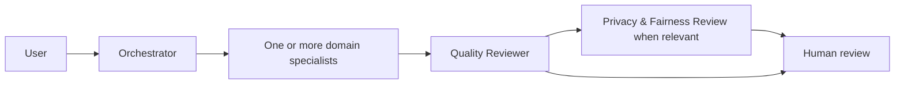

# Architecture

## Design summary

LinkedIn Skills is a content-first workflow library. Its core assets are independent `SKILL.md` instructions, role-specific agent prompts, host notes, examples, templates and structural evaluation cases. It has no required service, database, model SDK, browser plugin or API key.

## Layers

1. **Discovery:** `skills/README.md` indexes the 141 skills by domain.
2. **Task execution:** each `skills/<name>/SKILL.md` defines triggers, inputs, steps, output, examples and edge cases.
3. **Coordination:** `agents/orchestrator.md` chooses the smallest set of specialists and follows the shared handoff convention.
4. **Specialization:** 18 Markdown agent prompts define domain responsibilities and boundaries.
5. **Quality:** Quality Reviewer and Privacy & Fairness Reviewer check evidence, completeness, privacy and hiring safeguards.
6. **Reusable assets:** templates and examples provide starting structures; completed personal records stay outside this public repository.
7. **Validation:** Python validator, unit tests and GitHub Actions check repository conventions and catalogue integrity.

## Agent topology

## Model portability

A skill is plain Markdown and YAML frontmatter. Any model that can follow a detailed instruction and has enough context can use it when the file is attached or pasted. Automatic discovery, persistent skill loading, tools, memory, filesystem access and parallel delegation are properties of the host—not guarantees made by this repository. Host-specific setup is documented in `adapters/` and can change over time.

## Data flow

- Input: user request and the minimum necessary profile, job, company, or hiring context.
- Processing: skill instructions guide analysis, drafting or a structured plan.
- Output: editable text, a matrix, checklist, research brief or action plan.
- External action: performed separately by the user or an authorized application, never claimed by a skill.

## Why no LinkedIn integration is bundled

LinkedIn workflows can involve personal data, candidate records and account actions. The repository deliberately avoids scraping, session handling, prohibited automation and unapproved third-party integrations. This keeps the core portable and makes the human approval boundary explicit. A future integration would need separate platform authorization, security review, data governance and user consent; it is not implied by these Markdown skills.

## Extension points

- Add a new task folder with the required skill contract.
- Add a specialist prompt only when it represents a stable responsibility, not merely one skill name.
- Add an adapter only when host-specific discovery or invocation is understood and documented.
- Add evaluation cases with expected behaviours and negative constraints; report measured results only after a reproducible run.
